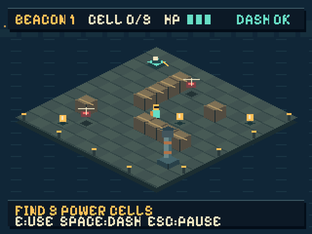

# Последний маяк / Last Beacon

**Изометрическая аркада для ANBERNIC RG40XX H / muOS.** Собери три энергоблока, включи маяк и вернись к лодке. Выбирай проходы между ящиками, обходи дронов или уходи от них рывком. После запуска маяка патрули ускоряются.



Версия **0.2.0** — первая небольшая играбельная сборка: три короткие экспедиции, открытие по порядку, лучшее время, звуки и сохранение прогресса. Пиксельные шрифты Jersey 20 и Pixelify Sans, экран 640 × 480, управление кнопками. Интерфейс пока английский.

## Установка на приставку

1. Скачай `last-beacon-0.2.0-muos.tar.gz` и `SHA256SUMS` из [релизов](https://github.com/volodymyrk8/last-beacon/releases).
2. Проверь SHA-256 и распакуй архив в корень карты с папками `ports` и `ROMS`, обычно `/mnt/mmc`.
3. Открой **Ports → LastBeacon**. Нужна muOS с установленным PortMaster.

Данные: `/mnt/mmc/ports/last-beacon`. Ярлык: `/mnt/mmc/ROMS/PORTS/LastBeacon.sh`. Сохранение: `save/profile.txt`, журнал: `last-beacon.log`. Обновление заменяет файлы игры; каталог `save` в архив не входит. Для другой точки монтирования скрипт также ищет `/mnt/sdcard/ports` и `/roms/ports`, либо принимает `BEACON_PORT_DIR`.

Пакет предназначен для **Linux AArch64 / RG40XX H / muOS**. На физической приставке проверена **muOS 2601.0 Jacaranda**. Другие прошивки, модели и версия 2601.1 отдельно не проверены. Игра использует системную SDL2 с backend Mali, без замены системных библиотек.

## Управление

| Действие | Приставка | Клавиатура |
|---|---|---|
| Движение по экрану | Крестовина / левый стик | Стрелки / WASD |
| Выбор экспедиции в меню | Крестовина влево / вправо | Стрелки влево / вправо |
| Начать / продолжить / следующая | A; Start в меню | Enter |
| Включить маяк рядом с ним | A | E |
| Рывок | B | Space |
| Пауза | Start | Esc |
| Продолжить из паузы | A / B / Start | Enter / Esc |
| Из паузы в меню | Select | Q |
| Звук | X | M |
| Выход из главного меню | Select | Q / Esc |

Энергоблоки собираются касанием. Три попадания дрона завершают вылазку; рывок защищает от контакта, но не проходит сквозь препятствия. Отсоединение контроллера или потеря фокуса ставит игру на паузу. Все три миссии доступны после последовательного прохождения; лучший результат сохраняется.

## Сборка отдельно от других проектов

На Mac или Linux нужны C++17, Make и SDL2 с `sdl2-config`:

```sh
make all test screenshots
make play
```

Сборка для muOS выполняется в Docker, используя закреплённый Linux ARM64 образ:

```sh
make muos
make package
```

Результат: `build/muos/last-beacon`, архив и контрольная сумма в `dist/`. Среда закреплена в `toolchain/image.lock`. На x86-хосте для запуска ARM64-контейнера требуется поддержка соответствующей архитектуры в Docker. Обычная сборка не скачивает графику, шрифты или игровые данные.

Если Docker недоступен, есть проверенный запасной путь на Zig 0.16.0. Скопируй системную AArch64 SDL2 с собственной приставки в `build/sysroot/libSDL2.so`, затем:

```sh
bash tools/build-muos-zig.sh
# На устройстве: ./world-test evidence/profile-test.txt
BEACON_SKIP_BUILD=1 bash packaging/package.sh
```

Этот путь использован для финальной сборки 0.2.0: Linux AArch64, glibc ≥ 2.31, Cortex-A53; C++ runtime статический, SDL2 системная. Библиотека из sysroot не включается в репозиторий или пакет. Лицензии статического LLVM runtime лежат в `licenses/`.

## Что проверено

- Логика на macOS и Linux ARM64: границы, препятствия, рывок, урон, пауза, поражение, все три маршрута до победы, траектории патрулей и сохранения.
- Меню, HUD, пауза и исходы отрисованы в 640 × 480.
- На RG40XX H: физический видеовывод Mali/OpenGL ES 2, кнопки через штатный evdev/SDL-маппинг, короткий замер работы и успешное прохождение третьей миссии автопилотом.
- [Аппаратный отчёт и ограничения](docs/HARDWARE.md). Это короткая проверка; длительные сеансы и сон/возобновление ещё не проверены.

## Архитектура

| Файл | Назначение |
|---|---|
| `src/levels.hpp` | Три карты, позиции блоков, маршруты и скорости патрулей |
| `src/world.hpp` | Игровая логика без зависимости от SDL |
| `src/render.hpp` | Изометрия, сортировка глубины, порт и интерфейс |
| `src/main.cpp` | SDL, управление, состояния меню, диагностические отчёты |
| `src/profile.hpp` | Открытые миссии и рекорды; запись через временный файл |
| `src/audio.hpp` | Собственные синтезированные эффекты, stereo 44,1 кГц |
| `src/demo.hpp` | Диагностический автопилот через обычную игровую логику |
| `assets/fonts/` | TTF-исходники, SIL OFL и воспроизводимый атлас |
| `tests/` | Прохождение и проверки правил |
| `tools/` | Сборка ARM64, атлас и явно запускаемая аппаратная проверка |

`DESIGN.md` описывает игровой замысел, `GAME-UI-SPEC.md` — интерфейс. Логический холст 320 × 240 увеличивается целым коэффициентом; на приставке это ровно 2×.

Исходники — MIT; шрифты — SIL OFL 1.1. Чужие игровые файлы, аккаунты и внешние сервисы для игры не нужны. Сетевая игра, редактор уровней и русская локализация в текущую версию не входят.
